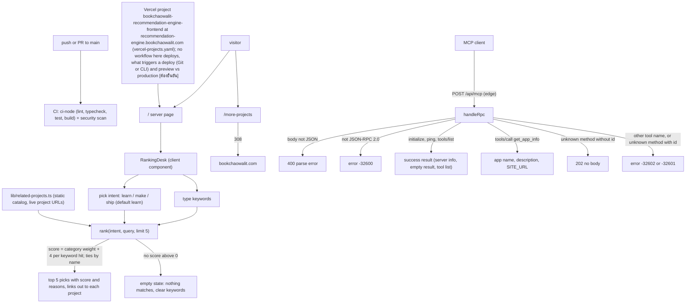
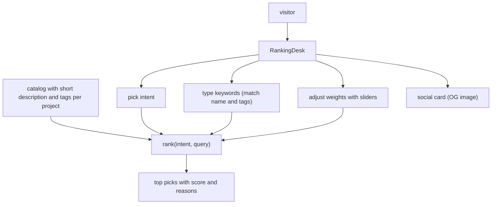

# 01 — Business process (As-Is / To-Be)

ai-recommendation-engine-web ("Ranking Desk") คือเว็บจัดอันดับโปรเจกต์ใน catalog ของ bookchaowalit ด้วยกฎที่กำหนดเอง (น้ำหนักตามหมวดและ intent บวกคีย์เวิร์ด) แล้วแสดงคะแนนพร้อมเหตุผลทุกข้อ ไม่ใช้โมเดล ไม่เก็บข้อมูลผู้ใช้ ทำงานในเบราว์เซอร์ทั้งหมด มี `/api/mcp` ให้ agent ถามข้อมูลแอป

Last reviewed: 2026-11-28 · commit `3c404eb`

## As-Is (จากโค้ดวันนี้)

Sources: `app/page.tsx`, `components/ranking-desk.tsx`, `lib/rank.ts`, `lib/related-projects.ts`, `lib/mcp.ts`, `app/api/mcp/route.ts`, `lib/site.ts`, `app/robots.ts`, `app/sitemap.ts`, `next.config.ts`, `.github/workflows/ci.yml`, `README.md`, `docs/UPGRADE-PLAN.md`, `repository-catalog/registries/vercel-projects.yaml` (bookchaowalit-empire)

ข้อเท็จจริงสำคัญจากโค้ด:

- ไม่มี database, ไม่มี fetch ไป backend, ไม่มี analytics หรือ Sentry ใน repo; ผลทั้งหมดคำนวณจาก catalog ที่ build มากับแอป
- keyword จับคู่กับ token ของชื่อ slug และชื่อหมวดเท่านั้น (ไม่มี description/tag ต่อโปรเจกต์)
- `SITE_URL` มาจาก `NEXT_PUBLIC_SITE_URL` หรือ default `https://recommendation-engine.bookchaowalit.com`; ค่าที่ไม่ใช่ http(s) URL ทำให้ build/โหลดโมดูลล้ม (`resolveSiteUrl` throw) ไม่ใช่ fallback เงียบ ๆ
- `robots.ts` ห้าม `/api/`; sitemap มีหน้าเดียว
- README ยังบอก default ว่า `https://bookchaowalit-recommendation-engine-frontend.vercel.app` แต่โค้ดใช้โดเมน `recommendation-engine.bookchaowalit.com` (เอกสารตกค้าง)
- `/api/mcp` ตอบสำเร็จสำหรับ `initialize`, `ping`, `tools/list` และ `tools/call get_app_info` เท่านั้น (`lib/mcp.ts`); 202 เฉพาะเมธอดที่ไม่รู้จักและไม่มี `id`; เมธอดที่รู้จักแต่ไม่มี `id` ยังได้ผลลัพธ์ที่มี `id: null`
- ทะเบียน `bookchaowalit-empire/repository-catalog/registries/vercel-projects.yaml` ระบุ Vercel project `bookchaowalit-recommendation-engine-frontend` และ URL `https://recommendation-engine.bookchaowalit.com`; ตัวกระตุ้น deploy (Git หรือ CLI) และสถานะ production จริงไม่อยู่ใน repo [ต้องยืนยัน]; CI ไม่ได้ deploy

## To-Be (จาก docs/UPGRADE-PLAN.md)

Sources: `docs/UPGRADE-PLAN.md` (Backlog P1, P2)

## Gap

| ID | As-Is → To-Be | Status | Owner | Evidence |
|---|---|---|---|---|
| G1 | keyword match on project name, slug and category label only (no descriptions or tags) → add short descriptions/tags per project while name, slug and category matching stay | todo | claude | `docs/UPGRADE-PLAN.md` P1 |
| G2 | fixed hand-set weights → visitor adjusts weights with sliders | todo | claude | `docs/UPGRADE-PLAN.md` P1 |
| G3 | no OG image → social card | todo | claude | `docs/UPGRADE-PLAN.md` P2 |

## Open questions

- README บรรทัด Configuration ระบุ default URL เก่า (`*.vercel.app`) ไม่ตรงกับ `lib/site.ts`
